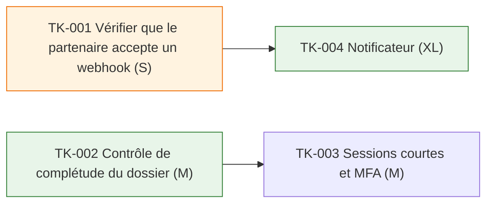

# Plan — Dossiers complets

**Version** : 1.0 — **Statut** : baseline — **Release** : REL-1 — **Cadence** : sprint — **PRD** : v1.0 — **Conception** : v1.0

> Document généré à partir de `state.yaml` et `refs.yaml` le 2026-10-20. Ne pas le modifier directement.

## En bref

| Stories | Prêtes | Tâches | Dont agent | Spikes ouverts | Questions ouvertes |
|---|---|---|---|---|---|
| 5 | 2 | 6 | 3 | 0 | 1 |

## 1. Story map de REL-1

| Activité | Tâche de la story map | Stories |
|---|---|---|
| ACT-01 Transmettre | T-01 Vérifier le dossier | US-001 (squelette) — prête ; US-005 — non prête |
| ACT-01 Transmettre | T-02 Prévenir le partenaire | US-002 — non prête |

## 2. Préparation des stories (Definition of Ready calculée)

| Story | Titre | Voie | FR ou origine | Temps | Taille | Règles | Exemples | Prête | Ce qui manque |
|---|---|---|---|---|---|---|---|---|---|
| [US-001](stories/US-001.md) | En tant qu'agente, je veux être bloquée si le justificatif manque, afin de ne pas transmettre un dossier incomplet | standard | FR-001 | ouverture | M | 1 | 2 | oui | — |
| [US-002](stories/US-002.md) | En tant qu'agente, je veux que le partenaire soit prévenu, afin d'éviter les relances | standard | FR-002 | milieu | M | 2 | 1 | non | 1 règle(s) sans exemple ; 1 question(s) ouverte(s) |
| [US-003](stories/US-003.md) | Libellé d'erreur peu clair | rapide | retour_utilisateur : SRC-020 | — | S | 0 | 1 | oui | — |
| [US-004](stories/US-004.md) | Changer le format de l'événement | rapide | observation : SRC-021 | — | L | 0 | 0 | non | aucun exemple (pour un défaut : la reproduction) |
| [US-005](stories/US-005.md) | Journal des refus | standard | FR-001 | ouverture | S | 0 | 0 | non | example mapping non fait ; aucune règle |

## 3. Tâches

| Tâche | Type | Titre | Story | Éléments | Taille | Affectation | Dépend de | Itération | Statut |
|---|---|---|---|---|---|---|---|---|---|
| [TK-005](tasks/TK-005.md) | dev | Reformuler le message | US-003 | Contrôle de complétude | S | agent | — | IT-1 | terminé |
| [TK-006](tasks/TK-006.md) | dev | Changer le schéma de DossierTransmis | US-004 | Notificateur | M | humain | — | — | validé |
| [TK-007](tasks/TK-007.md) | dev | Journal des refus | US-005 | Contrôle de complétude | S | humain | — | IT-2 | validé |
| [TK-001](tasks/TK-001.md) | spike | Vérifier que le partenaire accepte un webhook | spike H-001 | — | S | humain | — | IT-1 | terminé |
| [TK-002](tasks/TK-002.md) | dev | Contrôle de complétude du dossier | US-001 | Contrôle de complétude | M | agent | — | IT-1 | validé |
| [TK-003](tasks/TK-003.md) | securite | Sessions courtes et MFA | US-001 | API dossiers | M | humain | TK-002 | IT-1 | validé |
| [TK-004](tasks/TK-004.md) | dev | Notificateur | US-002 | Notificateur | XL | agent | TK-001 | IT-1 | validé |

## 4. Dépendances

_Une flèche va de la tâche préalable vers celle qui en dépend. Orange : spike ; vert : tâche confiée à un agent._

## 5. Itérations

### IT-1 — Bloquer les dossiers incomplets

Du 2026-10-26 au 2026-11-06 · Charge 11 / capacité 6 · Engagement : déclaré par Alice le 2026-10-23 · Statut : en_cours

- ✓ TK-005 (S, agent) — Reformuler le message
- ✓ TK-001 (S, humain) — Vérifier que le partenaire accepte un webhook
- TK-002 (M, agent) — Contrôle de complétude du dossier
- TK-003 (M, humain) — Sessions courtes et MFA
- TK-004 (XL, agent) — Notificateur

| Vélocité | Reste | Dont agents | Relecture humaine | Expérience | Fonctionnelle | Code |
|---|---|---|---|---|---|---|
| 2 | 9 | 1 | 1 | 3 | 4 | 4 |

Processus — on garde : ateliers de 20 min · on arrête : — · on essaie : relire les PR d'agents le matin

### IT-2 *(proposé)* — Journal

Du 2026-11-09 au 2026-11-20 · Charge 1 / capacité 6 · Engagement : **non déclaré** · Statut : proposé

- TK-007 (S, humain) — Journal des refus

### Hors itération

- TK-006 — Changer le schéma de DossierTransmis

## 6. Couverture de la conception

| Élément amont | Nature | Tâche |
|---|---|---|
| TH-001 | mesure de sécurité (S) | TK-003 |
| NR-01 | vérification NFR-001 (test_charge) | TK-002 |
| H-001 | spike | TK-001 |

## 6 bis. Releases : maturité et outcomes

### REL-1 — livrée

| Activité | Note | Remarque |
|---|---|---|
| ACT-01 Transmettre | B | message à affiner |

| Métrique | Comment | Fenêtre | Responsable |
|---|---|---|---|
| MET-01 — | taux de rejet dans l'outil partenaire | 4 semaines | Alice |

- 2026-11-20 — 3 agentes observées, aucune transmission incomplète

**Outcome** : partiel

## 7. Zones d'ombre et risques

| ID | Type | Question | Story | Adressée à | Bloquante |
|---|---|---|---|---|---|
| ZO-001 | question_story | Que faire si le partenaire ne répond pas ? | US-002 | Chloé | oui |

_Aucun élément._

## 8. Definition of Ready et Definition of Done

**Definition of Ready**

_Aucun élément._

**Definition of Done**

- Code revu et fusionné
- Exemples automatisés

## Couverture

| Métrique | Couverts | Taux | Seuil | Statut |
|---|---|---|---|---|
| FR de la release couvertes par une story | 2/2 | 100 % | 100 % | atteint |
| Mesures de sécurité planifiées | 1/1 | 100 % | 100 % | atteint |
| Vérifications de NFR (étape tests) planifiées | 1/1 | 100 % | 100 % | atteint |
| Stories prêtes | 2/5 | 40 % | 0 % | atteint |

## Annexe — Points de vérification

_Vérification de forme non bloquante (catalogue `lib/rules.mjs`). Elle ne remplace pas le contrôle formel._

| Élément | Règle | Avertissement |
|---|---|---|
| US-002 | S41 | règle Ne pas notifier le week-end sans exemple : on ne saura pas la tester |
| US-002 | S52 | règle « Ne pas notifier le week-end » sans référence amont : demande de changement au BRD ou au PRD |
| US-004 | S60 | voie rapide non conforme : taille L ; modifie un contrat d'interface ; suivre le chemin normal |
| EX-003 | S50 | exemple incomplet : when manquant(s) |
| TK-004 | S43 | tâche XL : trop grosse pour une PR, à découper |
| TK-004 | S45 | affectée à un agent alors que : taille XL au-delà de M ; story non prête |
| TK-007 | S40 | planifiée alors que sa story US-005 n'est pas prête |
| TK-004 | S40 | planifiée alors que sa story US-002 n'est pas prête |
| US-002 | S61 | story de milieu de partie planifiée avant des stories d'ouverture encore ouvertes (US-005) |
| IT-1 | S48 | charge 11 au-delà de la capacité 6 |

