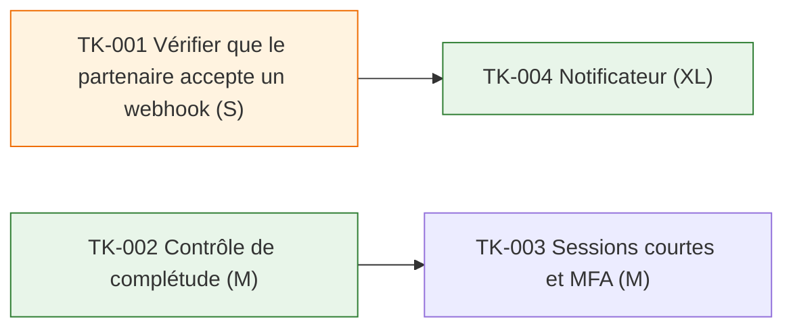

# Plan — Dossiers complets

**Version** : 1.0 — **Statut** : baseline — **Release** : REL-1 — **Cadence** : flux — **PRD** : v1.1 — **Conception** : v1.0

> Document généré à partir de `state.yaml` et `refs.yaml` le 2026-10-20. Ne pas le modifier directement.

## En bref

| Stories | Prêtes | Tâches | Dont agent | Spikes ouverts | Questions ouvertes |
|---|---|---|---|---|---|
| 2 | 1 | 3 | 2 | 1 | 1 |

## 1. Story map de REL-1

| Activité | Tâche de la story map | Stories |
|---|---|---|
| ACT-01 Transmettre | T-01 Vérifier le dossier | US-001 (squelette) — prête |
| ACT-01 Transmettre | T-02 Prévenir le partenaire | US-002 — non prête |

## 2. Préparation des stories (Definition of Ready calculée)

| Story | Titre | FR | Taille | Règles | Exemples | Prête | Ce qui manque |
|---|---|---|---|---|---|---|---|
| [US-001](stories/US-001.md) | En tant qu'agente, je veux être bloquée si le justificatif manque, afin de ne pas transmettre un dossier incomplet | FR-001 | M | 1 | 2 | oui | — |
| [US-002](stories/US-002.md) | En tant qu'agente, je veux que le partenaire soit prévenu, afin d'éviter les relances | FR-002 | M | 2 | 1 | non | 1 règle(s) sans exemple ; 1 question(s) ouverte(s) ; spike non terminé (TK-001) |

## 3. Tâches

| Tâche | Type | Titre | Story | Éléments | Taille | Affectation | Dépend de | Rang | Statut |
|---|---|---|---|---|---|---|---|---|---|
| [TK-001](tasks/TK-001.md) | spike | Vérifier que le partenaire accepte un webhook | spike H-001 | — | S | humain | — | 2 | validé |
| [TK-002](tasks/TK-002.md) | dev | Contrôle de complétude | US-001 | Contrôle de complétude | M | agent | — | 1 | validé |
| [TK-003](tasks/TK-003.md) | securite | Sessions courtes et MFA | US-001 | API dossiers | M | humain | TK-002 | 3 | validé |
| [TK-004](tasks/TK-004.md) | dev | Notificateur | US-002 | Notificateur | XL | agent | TK-001 | — | validé |

## 4. Dépendances

_Une flèche va de la tâche préalable vers celle qui en dépend. Orange : spike ; vert : tâche confiée à un agent._

## 5. Flux

Limite d'encours : 1 · En cours : 0 · Lot de réapprovisionnement : 3

### File « prêt »

| Rang | Tâche | Taille | Affectation | Story prête |
|---|---|---|---|---|
| 1 | TK-002 — Contrôle de complétude | M | agent | prête |
| 2 | TK-001 — Vérifier que le partenaire accepte un webhook | S | humain | n/a |
| 3 | TK-003 — Sessions courtes et MFA | M | humain | prête |

### Réapprovisionnements

| ID | Date | Tâches | Engagement |
|---|---|---|---|
| RP-1 | 2026-10-23 | TK-001, TK-002, TK-003 | Alice, 2026-10-23 |

## 6. Couverture de la conception

| Élément amont | Nature | Tâche |
|---|---|---|
| TH-001 | mesure de sécurité (S) | TK-003 |
| NR-01 | vérification NFR-001 (test_charge) | TK-002 |
| H-001 | spike | TK-001 |

## 7. Zones d'ombre et risques

| ID | Type | Question | Story | Adressée à | Bloquante |
|---|---|---|---|---|---|
| ZO-001 | question_story | Que faire si le partenaire ne répond pas ? | US-002 | Chloé | oui |

_Aucun élément._

## 8. Definition of Ready et Definition of Done

**Definition of Ready**

_Aucun élément._

**Definition of Done**

- Code revu et fusionné
- Exemples automatisés

## Annexe — Points de vérification

_Vérification de forme non bloquante (catalogue `lib/rules.mjs`). Elle ne remplace pas le contrôle formel._

| Élément | Règle | Avertissement |
|---|---|---|
| US-002 | S41 | règle Ne pas notifier le week-end sans exemple : on ne saura pas la tester |
| US-002 | S52 | règle « Ne pas notifier le week-end » sans référence amont : demande de changement au BRD ou au PRD |
| EX-003 | S50 | exemple incomplet : when manquant(s) |
| TK-004 | S43 | tâche XL : trop grosse pour une PR, à découper |
| TK-004 | S45 | affectée à un agent alors que : taille XL au-delà de M ; story non prête |

