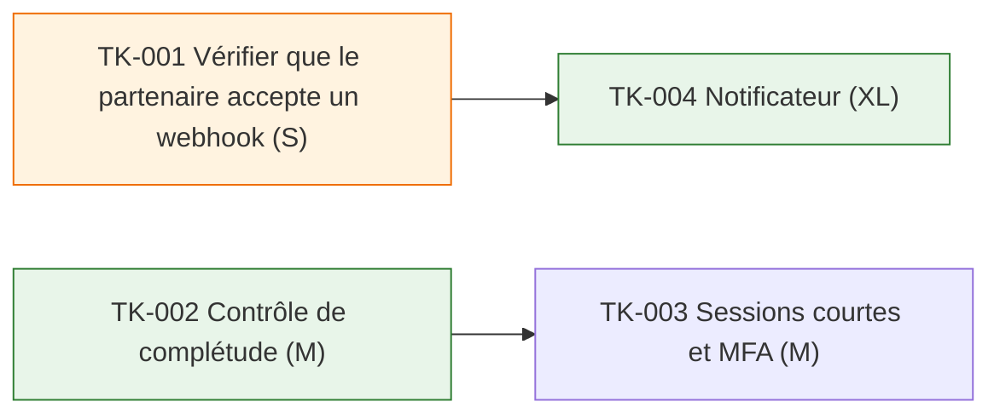

# Plan — Dossiers complets

**Version** : 1.0 — **Statut** : baseline — **Release** : REL-1 — **Cadence** : flux — **PRD** : v1.1 — **Conception** : v1.0

> **Copie de travail** — régénérée depuis `state.yaml` et `refs.yaml` le 2026-11-07, et réécrite à chaque génération. Ne la modifie pas directement : toute correction passe par l'état. Les versions figées, s'il y en a, sont dans `versions/`.

## En bref

| Stories | Prêtes | Tâches | Dont agent | Spikes ouverts | Questions ouvertes |
|---|---|---|---|---|---|
| 2 | 1 | 3 | 2 | 1 | 1 |

## 1. Story map de REL-1

| Activité | Tâche de la story map | Stories |
|---|---|---|
| ACT-01 Transmettre | T-01 Vérifier le dossier | US-001 (squelette) — prête |
| ACT-01 Transmettre | T-02 Prévenir le partenaire | US-002 — non prête |

## 2. Préparation des stories (Definition of Ready calculée)

| Story | Titre | Voie | FR ou origine | Temps | Taille | Règles | Exemples | Prête | Ce qui manque |
|---|---|---|---|---|---|---|---|---|---|
| [US-001](stories/US-001.md) | En tant qu'agente, je veux être bloquée si le justificatif manque, afin de ne pas transmettre un dossier incomplet | standard | FR-001 | — | M | 1 | 2 | oui | — |
| [US-002](stories/US-002.md) | En tant qu'agente, je veux que le partenaire soit prévenu, afin d'éviter les relances | standard | FR-002 | — | M | 2 | 1 | non | 1 règle(s) sans exemple ; 1 question(s) ouverte(s) ; spike non terminé (TK-001) |

## 3. Tâches

_Quand les agents réalisent les tâches, la taille mesure le risque (allers-retours, attention humaine), pas l'effort de codage. Le risque est calculé depuis les données de la tâche ; l'attention prévue est en minutes de validation, de réponses et de revue humaines._

| Tâche | Type | Titre | Story | Éléments | Taille | Risque calculé | Attention prévue | Affectation | Dépend de | Rang | Statut |
|---|---|---|---|---|---|---|---|---|---|---|---|
| [TK-001](tasks/TK-001.md) | spike | Vérifier que le partenaire accepte un webhook | spike H-001 | — | S | **M** | 45 min | humain | — | 2 | validé |
| [TK-002](tasks/TK-002.md) | dev | Contrôle de complétude | US-001 | Contrôle de complétude | M | M | 70 min | agent | — | 1 | validé |
| [TK-003](tasks/TK-003.md) | securite | Sessions courtes et MFA | US-001 | API dossiers | M | M | 70 min | humain | TK-002 | 3 | validé |
| [TK-004](tasks/TK-004.md) | dev | Notificateur | US-002 | Notificateur | XL | **M** | 135 min | agent | TK-001 | — | validé |

## 4. Dépendances

_Une flèche va de la tâche préalable vers celle qui en dépend. Orange : spike ; vert : tâche confiée à un agent._

## 5. Flux

Limite d'encours : 1 · En cours : 0 · Lot de réapprovisionnement : 3

### File « prêt »

| Rang | Tâche | Taille | Affectation | Story prête |
|---|---|---|---|---|
| 1 | TK-002 — Contrôle de complétude | M | agent | prête |
| 2 | TK-001 — Vérifier que le partenaire accepte un webhook | S | humain | n/a |
| 3 | TK-003 — Sessions courtes et MFA | M | humain | prête |

### Réapprovisionnements

| ID | Date | Tâches | Engagement |
|---|---|---|---|
| RP-1 | 2026-10-23 | TK-001, TK-002, TK-003 | Alice, 2026-10-23 |

## 6. Couverture de la conception

| Élément amont | Nature | Tâche |
|---|---|---|
| TH-001 | mesure de sécurité (S) | TK-003 |
| NR-01 | vérification NFR-001 (test_charge) | TK-002 |
| H-001 | spike | TK-001 |

## 6 bis. Releases : maturité et outcomes

_Aucun suivi de release enregistré._

## 7. Zones d'ombre et risques

| ID | Type | Question | Story | Adressée à | Bloquante |
|---|---|---|---|---|---|
| ZO-001 | question_story | Que faire si le partenaire ne répond pas ? | US-002 | Chloé | oui |

_Aucun élément._

## 8. Definition of Ready et Definition of Done

**Definition of Ready**

_Aucun élément._

**Definition of Done**

- Code revu et fusionné
- Exemples automatisés

## Couverture

| Métrique | Couverts | Taux | Seuil | Statut |
|---|---|---|---|---|
| FR de la release couvertes par une story | 2/2 | 100 % | 100 % | atteint |
| Mesures de sécurité planifiées | 1/1 | 100 % | 100 % | atteint |
| Vérifications de NFR (étape tests) planifiées | 1/1 | 100 % | 100 % | atteint |
| Stories prêtes | 1/2 | 50 % | — | _indicatif_ |

## Annexe — Points de vérification

_Vérification de forme non bloquante (catalogue `lib/rules.mjs`). Elle ne remplace pas le contrôle formel._

| Élément | Règle | Avertissement |
|---|---|---|
| US-002 | S41 | règle Ne pas notifier le week-end sans exemple : on ne saura pas la tester |
| US-002 | S52 | règle « Ne pas notifier le week-end » sans référence amont : demande de changement au BRD ou au PRD |
| EX-003 | S50 | exemple incomplet : when manquant(s) |
| TK-004 | S43 | tâche XL : trop grosse pour une PR, à découper |
| TK-004 | S45 | affectée à un agent alors que : taille XL au-delà de M ; story non prête |
| TK-004 | S74 | taille XL retenue, taille de risque calculée M (opérations de contrat 2, règles métier de la story 1) : écart à justifier |

---

## Relecture humaine

> Ce plan a été produit avec l'assistance d'une IA, à partir de l'état de session et des sources citées. Il ne remplace ni les entretiens, ni l'observation, ni le jugement des personnes concernées. Il doit être relu par les personnes désignées ; seules les approbations déclarées et enregistrées dans l'état font foi, et aucune n'est déduite de la présence de ce document.
