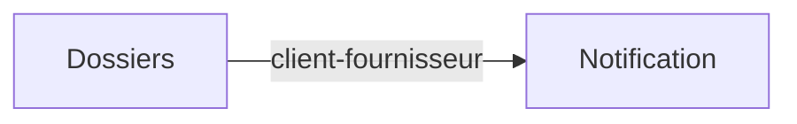
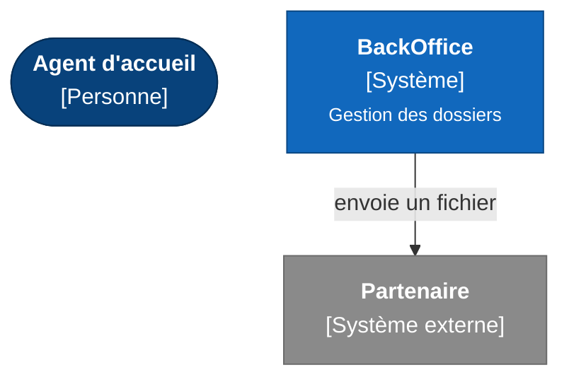
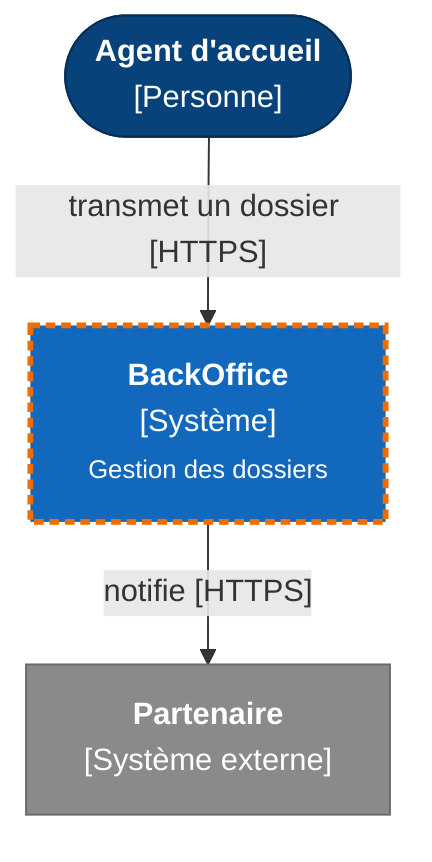
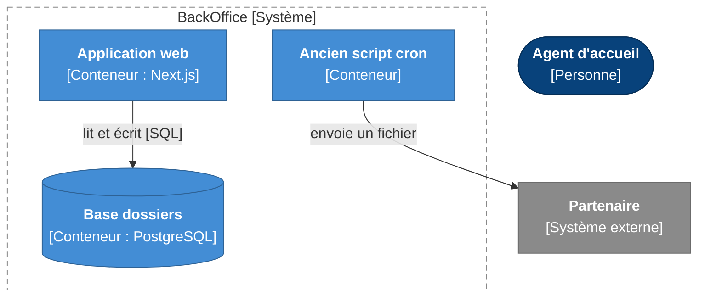
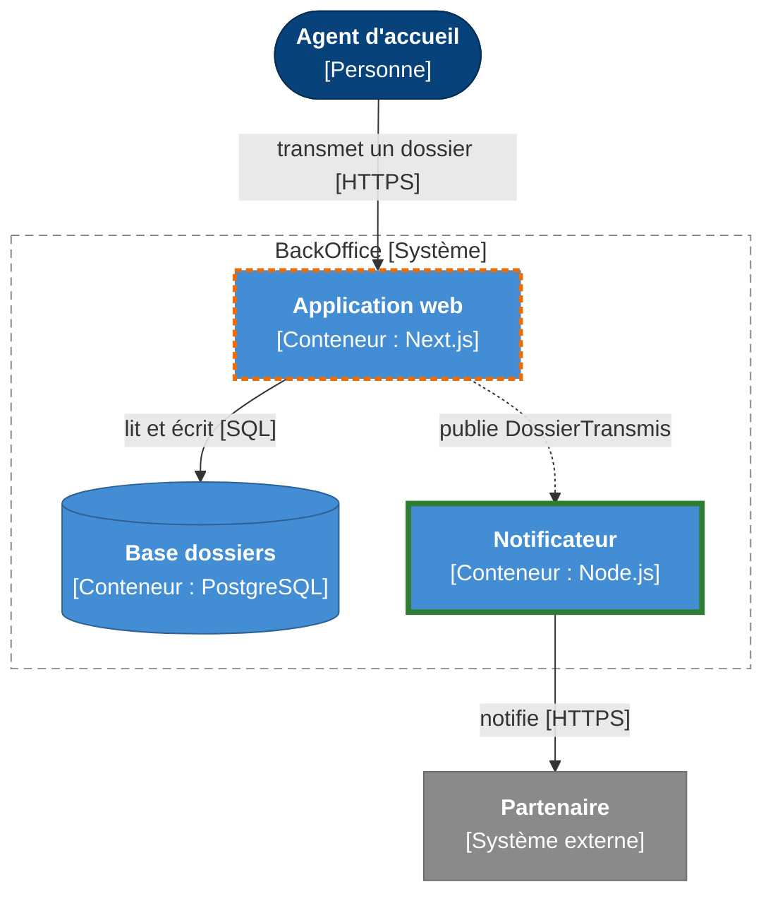
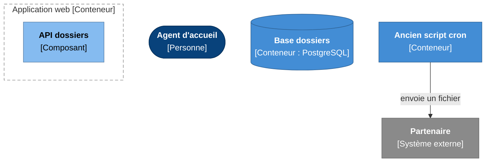
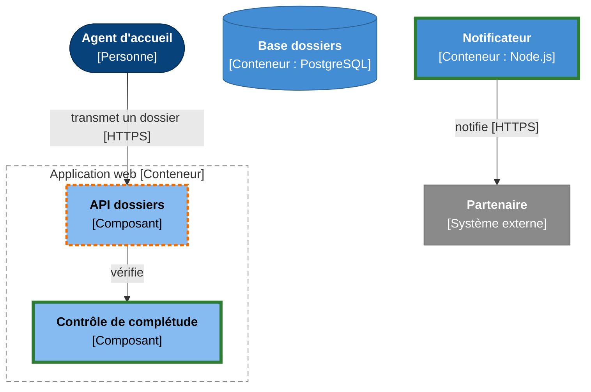

# SAD — Dossiers complets

**Version** : 1.0 — **Statut** : baseline — **Contexte** : brownfield — **PRD** : v1.0

> Document généré à partir de `state.yaml` le 2026-10-21. Ne pas le modifier directement : toute correction passe par l'état de session.

## Statut du document

| Section | Statut |
|---|---|
| Contexte et périmètre | à rédiger |
| Moteurs architecturaux | à rédiger |
| Domaine | à rédiger |
| Vues C4 | à rédiger |
| Décisions | à rédiger |
| Réponses aux NFR | à rédiger |
| Données et interfaces | à rédiger |
| Sécurité | à rédiger |
| Existant | à rédiger |
| Hypothèses et risques | à rédiger |

## 1. Contexte et périmètre

**Problème** : Trop de dossiers transmis incomplets.

**Vision** : Les agents transmettent des dossiers complets du premier coup.

**Existant concerné** : API dossiers et base

### Contraintes

| ID | Contrainte | Origine |
|---|---|---|
| CON-01 | Hébergement HDS | PRD — Juridique |

## 2. Moteurs architecturaux

| ID | Type | Importance | Difficulté | Origine | Mesure |
|---|---|---|---|---|---|
| AD-02 | conformité | haute | haute | CON-01 | — |
| AD-01 | performance | haute | moyenne | NFR-001 | p95 < 2 s |

### AD-02 — conformité

| Source | Stimulus | Environnement | Artefact | Réponse | Mesure |
|---|---|---|---|---|---|
| Auditeur | contrôle | — | — | données hébergées HDS | — |

### AD-01 — performance

| Source | Stimulus | Environnement | Artefact | Réponse | Mesure |
|---|---|---|---|---|---|
| Agent | transmet un dossier | charge nominale | API dossiers | le contrôle répond rapidement | p95 < 2 s |

## 3. Domaine

| ID | Contexte | Responsabilité | Agrégats | Règles garanties |
|---|---|---|---|---|
| CTX-01 | Dossiers | Constituer et transmettre les dossiers | Dossier | RG-001 |
| CTX-02 | Notification | Prévenir les partenaires | — | — |

### Carte des contextes

_Les flèches vont du contexte amont vers le contexte aval._

## 4. Vues C4

_En vue cible, trait vert épais : nouvel élément ; trait orange pointillé : élément existant modifié. Les éléments remplacés ou retirés n'apparaissent qu'en vue actuelle._

### 1. Contexte

**Niveau 1 : contexte — état actuel**

**Niveau 1 : contexte — état cible**

### 2. Conteneurs

**Niveau 2 : conteneurs de BackOffice — état actuel**

**Niveau 2 : conteneurs de BackOffice — état cible**

### 3. Composants

**Niveau 3 : composants de Application web — état actuel**

**Niveau 3 : composants de Application web — état cible**

### Catalogue des éléments

| ID | Type | Nom | Technologie | Parent | Cycle de vie | Contextes | Équipe |
|---|---|---|---|---|---|---|---|
| PS-01 | personne | Agent d'accueil | — | — | existant conservé | — | — |
| SYS-01 | système | BackOffice | — | — | existant modifié | — | — |
| SYS-02 | système externe | Partenaire | — | — | existant conservé | — | — |
| CT-01 | conteneur | Application web | Next.js | BackOffice | existant modifié | CTX-01 | Équipe web |
| CT-02 | conteneur | Base dossiers | PostgreSQL | BackOffice | existant conservé | — | — |
| CT-03 | conteneur | Notificateur | Node.js | BackOffice | nouveau | CTX-02 | Équipe web |
| CT-04 | conteneur | Ancien script cron | — | BackOffice | existant remplacé | — | — |
| CP-01 | composant | Contrôle de complétude | — | Application web | nouveau | — | — |
| CP-02 | composant | API dossiers | — | Application web | existant modifié | — | — |

## 5. Décisions d'architecture

| ID | Décision | Statut | Option retenue | Moteurs | Décidé par |
|---|---|---|---|---|---|
| [ADR-001](adr/ADR-001-notifier-le-partenaire-par-un-worker-asynchrone.md) | Notifier le partenaire par un worker asynchrone | accepté | Worker asynchrone | AD-01 | Alice |

## 6. Allocation des exigences fonctionnelles

| FR | Priorité | Release | Éléments |
|---|---|---|---|
| FR-001 | Must | REL-1 | CT-01 Application web, CP-01 Contrôle de complétude |
| FR-002 | Should | REL-1 | CT-03 Notificateur |
| FR-003 | Won't | REL-2 | n/a |

## 7. Réponses aux exigences non fonctionnelles

| NFR | Cible | Tactiques | Éléments | ADR | Vérification | Étape |
|---|---|---|---|---|---|---|
| NFR-001 | p95 < 2 s | traitement asynchrone de la notification | Notificateur | ADR-001 | test de charge — p95 transmission | tests |
| NFR-002 | 99,5 % | **sans réponse** | — | — | — | — |

## 8. Données et interfaces

### Données

| ID | Donnée | Contexte | Source de vérité | Classification | Conservation |
|---|---|---|---|---|---|
| DAT-01 | Dossier | CTX-01 | Base dossiers | santé | 10 ans après clôture |
| DAT-02 | Notification | CTX-02 | Notificateur | interne | — |

### Interfaces

#### API-01 — API dossiers (openapi)

Fournisseur : Application web · Consommateurs : Agent d'accueil · Cycle de vie : existant_modifié · Squelette : `contracts/API-01.openapi.yaml`

| ID | Opération | But | FR | Données | Authentification |
|---|---|---|---|---|---|
| OP-001 | POST /dossiers/{id}/transmission | Transmettre un dossier | FR-001 | DAT-01 | session agent |
| OP-002 | GET /health | Sonde | — | — | — |

#### API-02 — Événements dossiers (asyncapi)

Fournisseur : Application web · Consommateurs : Notificateur · Cycle de vie : — · Squelette : `contracts/API-02.asyncapi.yaml`

| ID | Opération | But | FR | Données | Authentification |
|---|---|---|---|---|---|
| OP-003 | DossierTransmis | Annonce une transmission | FR-002 | DAT-01 | — |

## 9. Sécurité

### Frontières de confiance

| ID | Frontière | Éléments |
|---|---|---|
| TB-01 | Internet / zone HDS | Application web, Base dossiers, Notificateur |

### Menaces

| STRIDE | S | T | R | I | D | E |
|---|---|---|---|---|---|---|
| Nombre | 1 | 0 | 0 | 0 | 1 | 0 |

Référentiels de contrôles retenus : OWASP ASVS (version du projet)

| ID | Catégorie | Cible | Menace | Niveau | Traitement | Mesures | Contrôles | Accepté par |
|---|---|---|---|---|---|---|---|---|
| TH-001 | Usurpation | LNK-001 (Agent d'accueil → API dossiers) | vol de session agent | élevé | atténuer | sessions courtes ; MFA | — | — |
| TH-002 | Déni de service | Notificateur | file saturée | faible | accepter | — | — | — |

## 10. Existant

| Cycle de vie | Éléments |
|---|---|
| existant conservé | Agent d'accueil, Partenaire, Base dossiers |
| existant modifié | BackOffice, Application web, API dossiers |
| existant remplacé | Ancien script cron |
| existant retiré | — |
| nouveau | Notificateur, Contrôle de complétude |

### Dette technique concernée

| ID | Dette | Éléments | Impact | Preuves |
|---|---|---|---|---|
| DT-01 | Pas de tests sur l'API dossiers | API dossiers | régressions | SRC-001 |

### Sources de l'inventaire

| ID | Type | Référence |
|---|---|---|
| SRC-001 | code | backoffice@a1b2:src/app/api/dossiers/route.ts |
| SRC-002 | configuration | backoffice@a1b2:docker-compose.yml |

## 11. Hypothèses, spikes et risques

| ID | Hypothèse | Validation | Statut |
|---|---|---|---|
| H-001 | Le partenaire accepte un webhook | spike : appel de test | à vérifier |

### Risques

_Aucun élément._

## 12. Glossaire

_Aucun élément._

## Couverture

| Métrique | Couverts | Taux | Seuil | Statut |
|---|---|---|---|---|
| FR allouées à un conteneur ou composant | 2/2 | 100 % | 100 % | atteint |
| NFR avec une réponse de conception | 1/2 | 50 % | 100 % | **non atteint** (manquent : NFR-002) |
| Moteurs servis par un ADR accepté ou une réponse | 1/2 | 50 % | 100 % | **non atteint** (manquent : AD-02) |

## Annexe — Points de vérification

_Vérification de forme non bloquante (catalogue `lib/rules.mjs`). Elle ne remplace pas le contrôle formel._

| Élément | Règle | Avertissement |
|---|---|---|
| AD-01 | L01 | terme non mesurable « rapidement » : remplacer par un comportement observable ou une valeur cible |
| AD-02 | S22 | scénario de qualité sans mesure chiffrée |
| ADR-002 | S23 | ADR avec moins de deux options : ce n'est pas une décision |
| ADR-002 | S24 | ADR sans moteur : on ne saura pas quand le remettre en cause |
| CT-04 | S36 | élément remplacé sans remplaçant désigné |
| LNK-006 | S28 | relation existante sans preuve |
| NFR-002 | S27 | NFR sans réponse de conception |
| DAT-01 | S31 | donnée sante sans menace de divulgation (I) examinée sur CT-02 |
| DAT-02 | S30 | donnée sans conservation |
| OP-002 | S29 | opération qui ne sert aucune FR |
| TH-001 | S55 | mesure sans contrôle de référence (OWASP ASVS (version du projet)) |
| TH-002 | S32 | menace acceptée sans décideur déclaré |

---

## Relecture humaine

> Ce dossier d’architecture a été produit avec l'assistance d'une IA, à partir de l'état de session et des sources citées. Il ne remplace ni les entretiens, ni l'observation, ni le jugement des personnes concernées. Il doit être relu par les personnes désignées ; seules les approbations déclarées et enregistrées dans l'état font foi, et aucune n'est déduite de la présence de ce document.
