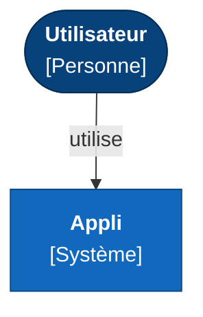
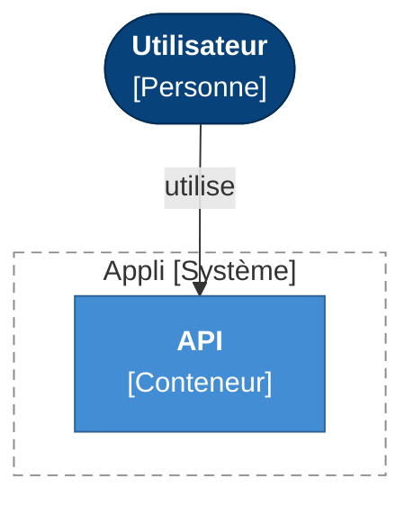

# SAD — Green

**Version** : 0.1 — **Statut** : — — **Contexte** : greenfield — **PRD** : v—

> Document généré à partir de `state.yaml` le 2026-10-20. Ne pas le modifier directement : toute correction passe par l'état de session.

## Statut du document

| Section | Statut |
|---|---|
| Contexte et périmètre | à rédiger |
| Moteurs architecturaux | à rédiger |
| Domaine | à rédiger |
| Vues C4 | à rédiger |
| Décisions | à rédiger |
| Réponses aux NFR | à rédiger |
| Données et interfaces | à rédiger |
| Sécurité | à rédiger |
| Hypothèses et risques | à rédiger |

## 1. Contexte et périmètre

**Problème** : —

**Vision** : —

### Contraintes

_Aucun élément._

## 2. Moteurs architecturaux

_Aucun élément._

## 3. Domaine

_Aucun élément._

## 4. Vues C4

### 1. Contexte

**Niveau 1 : contexte**

### 2. Conteneurs

**Niveau 2 : conteneurs de Appli**

### Catalogue des éléments

| ID | Type | Nom | Technologie | Parent | Contextes | Équipe |
|---|---|---|---|---|---|---|
| PS-01 | personne | Utilisateur | — | — | — | — |
| SYS-01 | système | Appli | — | — | — | — |
| CT-01 | conteneur | API | — | Appli | — | — |

## 5. Décisions d'architecture

_Aucun élément._

## 6. Allocation des exigences fonctionnelles

| FR | Priorité | Release | Éléments |
|---|---|---|---|
| FR-001 | Must | — | CT-01 API |

## 7. Réponses aux exigences non fonctionnelles

_Aucun élément._

## 8. Données et interfaces

### Données

_Aucun élément._

### Interfaces

## 9. Sécurité

### Frontières de confiance

_Aucun élément._

### Menaces

| STRIDE | S | T | R | I | D | E |
|---|---|---|---|---|---|---|
| Nombre | 0 | 0 | 0 | 0 | 0 | 0 |

_Aucun élément._

## 10. Hypothèses, spikes et risques

_Aucun élément._

### Risques

_Aucun élément._

## 11. Glossaire

_Aucun élément._

## Annexe — Points de vérification

_Vérification de forme non bloquante (catalogue `lib/rules.mjs`). Elle ne remplace pas le contrôle formel._

_Aucun avertissement._

